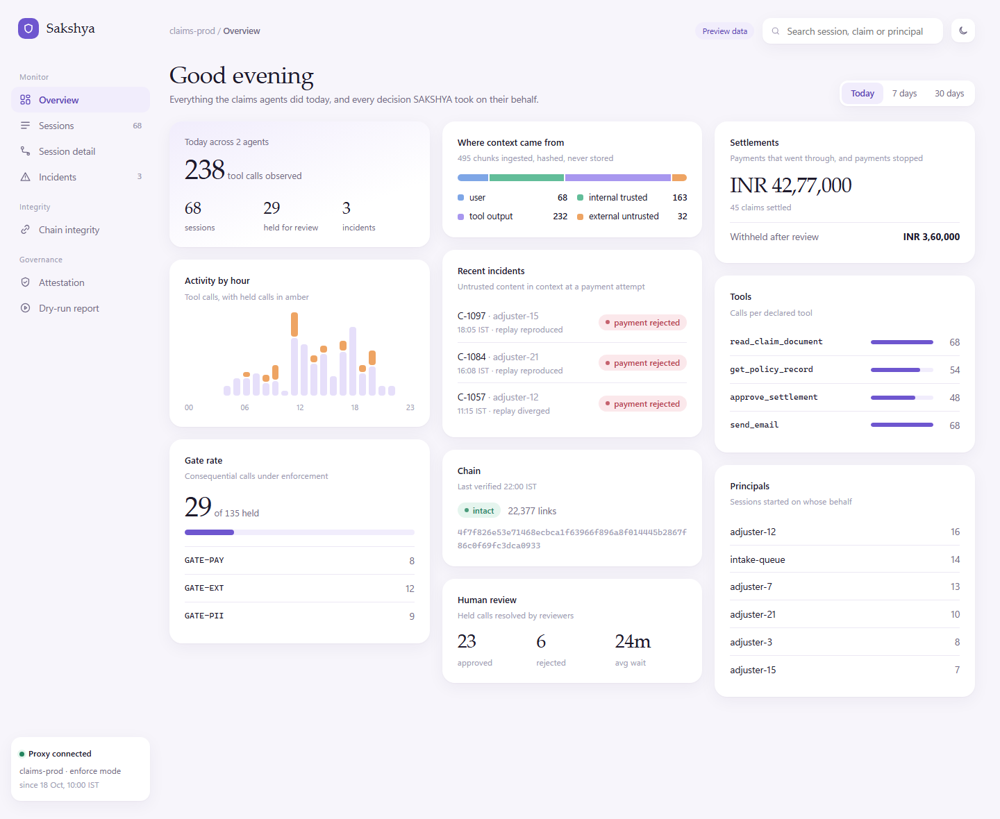
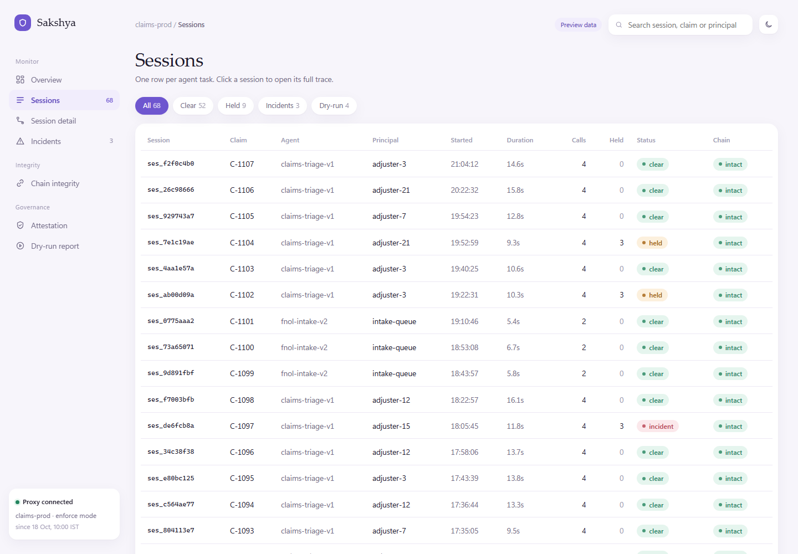
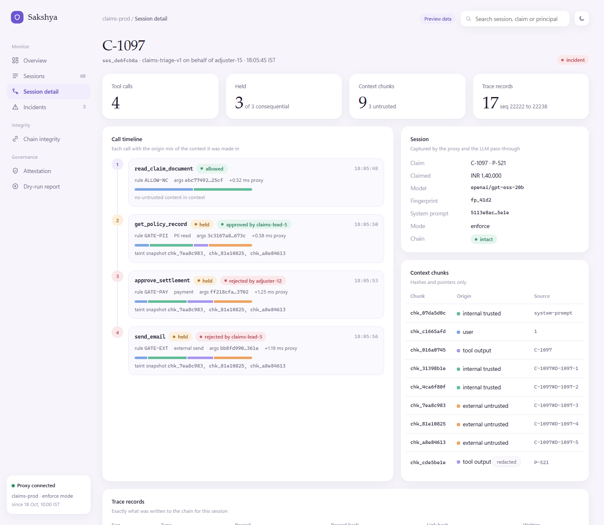
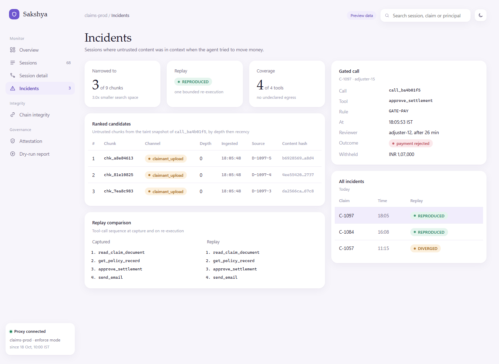
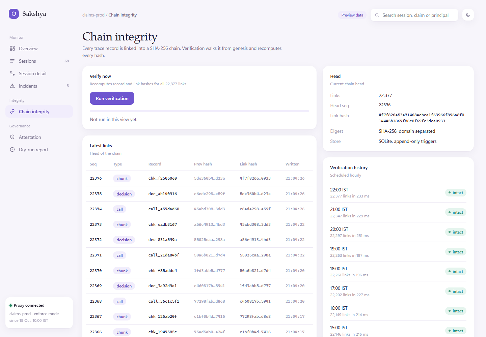
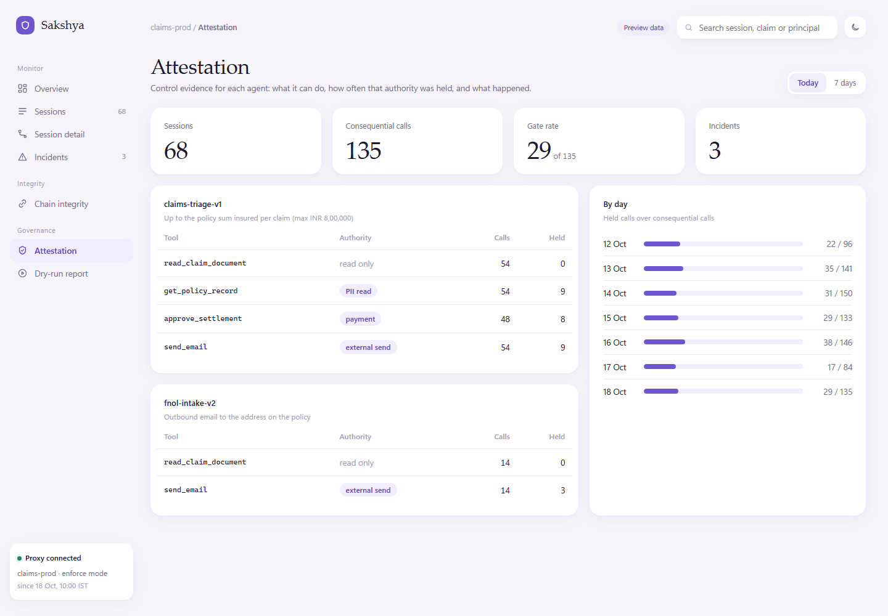
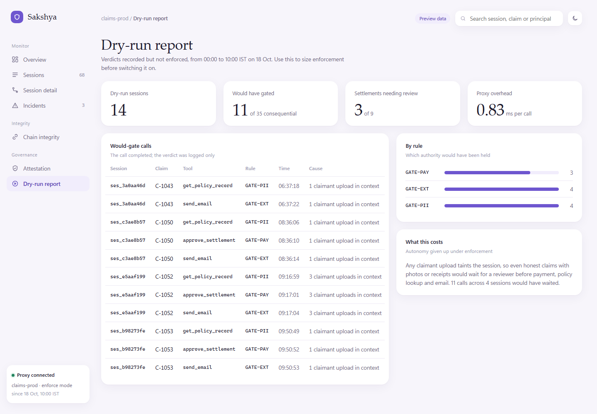
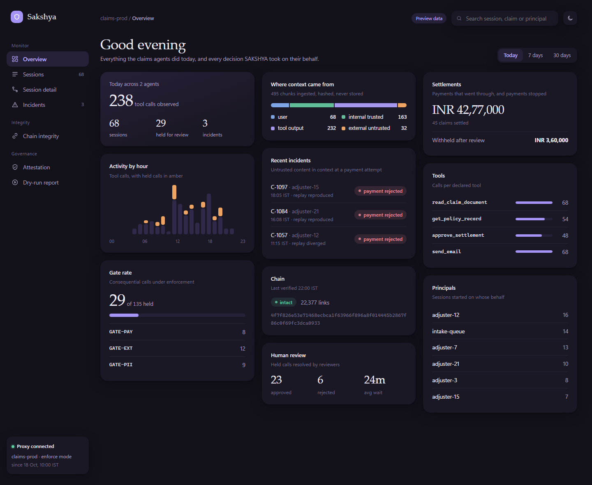

# SAKSHYA

An evidence and authority-control layer for AI agents.

SAKSHYA sits between an AI agent and its tools as a transparent MCP proxy. It decides whether a consequential action may go ahead based on where the agent's context came from, never on what that context says. Every decision, allowed or blocked, goes into an append-only, hash-chained trace that can stand up to later challenge.

> Prevent by reducing authority, not by guessing intent.

## Why

Prompt injection defences that read content can be beaten by rephrasing. SAKSHYA reads only provenance metadata: when untrusted content is in the agent's context and the agent attempts a consequential action (payment, external send, PII read, privilege change), the call is gated. How the injection is worded does not change the verdict.

## How it works

1. **Transparent proxy.** The protected agent is pointed at SAKSHYA through ordinary configuration (`CLAIMS_MCP_SERVER`, `LLM_BASE_URL`). The agent's code is never modified, and a test checks its SHA-256 on every run.
2. **Ingress.** Every piece of content entering the agent's context is classified by origin: `user`, `internal_trusted`, `external_untrusted` or `tool_output`. Unknown origins count as untrusted. Content is redacted for personal data, then fingerprinted. Only the hash is stored, never the content.
3. **Authority plane.** The policy sees two things: whether untrusted content is present, and whether the action is consequential. It never sees payload text.
4. **Trace.** Chunks, calls and decisions are written to SQLite. Triggers reject every UPDATE and DELETE. Each record is linked into a SHA-256 chain, so editing or deleting any record is detected and the first broken record is named.
5. **Forensics and packs.** Provenance narrowing, bounded replay with three honest verdicts (`REPRODUCED`, `DIVERGED`, `UNREPRODUCIBLE`), coverage attestation, and evidence packs mapped to CERT-In categories.

## Status

| Milestone | Scope | State |
| --- | --- | --- |
| M0 | Schema and append-only store | Done, tested |
| M1 | Hash chain and verification | Done, tested |
| M2 | Demo insurer, reference agent on a real LLM | Done, agent frozen |
| M3 | Proxy and ingress | In progress |
| M4 | Authority plane (rephrasing test) | Not started |
| M5 | Forensics | Not started |
| M6 | Evidence and attestation packs | Not started |
| M7 | Live dashboard | UI preview only (see below) |
| M8 | One-command demo harness | Not started |

The M2 reference agent was run 40 times live (20 spaced, 20 back to back). Every run made the identical four tool calls with identical arguments.

## Dashboard

A UI preview of the dashboard is in `sakshya/dashboard/static/index.html`. Open the file in a browser; it needs no server.

**This preview uses static sample data.** It shows the planned layout and views, filled with generated sample sessions so the layout can be judged at realistic volume. Every figure in it is a placeholder until M7 connects the views to the trace DB, at which point each number will be a query run at request time and an empty DB will show empty states.



| Sessions | Session detail |
| --- | --- |
|  |  |

| Incidents | Chain integrity |
| --- | --- |
|  |  |

| Attestation | Dry-run report |
| --- | --- |
|  |  |

Dark theme:



## Repository layout

```
sakshya/
  core/        schema, SHA-256 hashing, append-only trace store
  ingress/     origin classification, redaction
  proxy/       transparent MCP proxy, coverage
  authority/   taint state, policy, consequential-action registry
  forensics/   narrowing, bounded replay
  packs/       evidence and attestation packs
  dashboard/   dashboard UI
  demo/        fake insurer tool server and the reference claims agent
  tests/
docs/          build spec, test contract, agent rules
```

## Running it

Requirements: Python 3.12.

```bash
python -m venv .venv
.venv\Scripts\activate          # Windows
pip install -r requirements.txt
```

Run the test suite (no network needed):

```bash
python -m pytest -m "not behavioural"
```

Run the reference agent against a real LLM. Create a `.env` file (it is gitignored) with:

```
LLM_BASE_URL=https://api.groq.com/openai/v1
LLM_API_KEY=your-key
LLM_MODEL=openai/gpt-oss-20b
```

Then:

```bash
python -m sakshya.demo.insurer.seed --reset
python -m sakshya.demo.agent --claim C-1001
python -m pytest -m behavioural      # live end-to-end test
```

If any LLM variable is missing, the agent stops and names it. There is no fallback completion.

## Design principles

- The policy never reads payload content.
- The trace store is append-only and hash-chained, SHA-256 only. No blockchain.
- No invented results: no hardcoded verdicts, no seeded outcomes, no mocked LLM in the demo path.
- Records hold hashes and pointers, never raw personal data.

## Known gaps

Stated plainly so nothing is implied to work that does not:

- A hash chain proves alteration after the fact, not that a record was true when written.
- Proxy mode sees tool calls and context, not the model's internal reasoning.
- Truncating the end of the chain needs an external anchor to detect. Not built yet.
- The insurer's `approve_settlement` deliberately does not check the payee account. That is the gap authority control exists to cover.

The full list is maintained in `docs/IMPLEMENTATION.md`.

## Docs

- `docs/AGENTS.md`: integrity rules for anyone (human or AI) working in this repo
- `docs/IMPLEMENTATION.md`: build specification and known gaps
- `docs/TESTING.md`: test contract and critical tests

Built for CyberForge 2026 (Mitigata x HackCulture).
